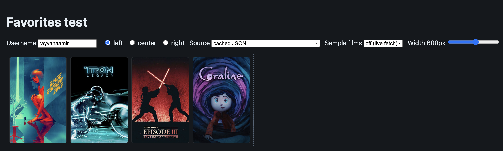
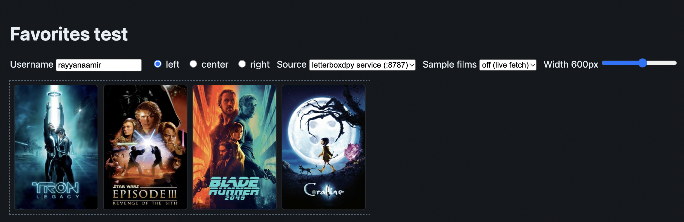

# react-letterboxd-favorites

Show a Letterboxd user's four favorite films in a React or Next.js app.



- **Works without a server.** Sync your favorites once, locally. The component then reads a static JSON file from your `public/` folder, so the site needs no proxy and makes no request to Letterboxd at runtime.
- **Custom posters.** If you've picked custom posters as a Letterboxd Patron, `sync` saves those. `--default-posters` switches back to the standard ones. **NOTE:** Other retrieval approaches than `sync` retrieve defaults only.
- Posters keep the same left-to-right order as the profile. 1–3 favorites can be aligned `left`, `center` or `right`.
- Hovering (or focusing) a poster shows the title, year and a "View on Letterboxd" link.
- Unstyled by default except for an optional stylesheet; every element takes extra classes.
- Live scraping (through a CORS proxy, or in Next.js Server Components) is still there as an **experimental** fallback.

> Not affiliated with or endorsed by Letterboxd. Letterboxd is a trademark of Letterboxd Limited.

## Contents

- [Install](#install)
- [Three ways to get the data](#three-ways-to-get-the-data)
- [Quick start (cached)](#quick-start-cached)
- [Custom posters (Letterboxd Patron)](#custom-posters-letterboxd-patron)
- [Next.js](#nextjs)
- [CLI reference](#cli-reference)
- [Cache file](#cache-file)
- [Experimental: live scraping](#experimental-live-scraping)
- [Props](#props) · [Styling](#styling) · [Errors](#errors)
- [How it works](#how-it-works) · [Limitations](#limitations) · [Development](#development) · [License](#license)

## Install

```bash
npm install react-letterboxd-favorites
```

## Three ways to get the data

All three have been tested against a real profile.

| Approach | Talks to Letterboxd | Needs | Custom posters | Status |
|---|---|---|---|---|
| **Cached JSON** via `sync` (default) | Once, from your machine | The letterboxdpy bridge *or* a saved profile page, only while syncing | Yes (through the bridge) | Recommended |
| Live scrape through the letterboxdpy bridge | On every page load | A Python server running next to your site | No | Experimental |
| Live scrape directly (`corsProxy` / `getFavorites`) | On every page load | A proxy or server IP that Cloudflare doesn't block | No | Experimental, usually 403 |

## Quick start (cached)

Letterboxd has no API and is behind Cloudflare, which blocks plain `fetch` requests with a 403. Favorites rarely change, so the package fetches them **once, on your machine**, and saves them as JSON in your app's `public/` folder. Your site only ever reads that file.

**1. Sync your favorites** (in development, from your app's root):

```bash
npx react-letterboxd-favorites sync rayyanaamir
# → public/letterboxd-favorites/rayyanaamir.json
```

By default this goes through the [letterboxdpy bridge](playground/letterboxdpy-service), a small local Python server (Python 3.10+) that gets past Cloudflare. Start it first (see its README). No Python? Use a saved page instead:

1. Open `https://letterboxd.com/<username>/` in a **private/incognito window** (so the page carries no login session) and choose **Save Page As → Web Page, HTML Only**.
2. Run:

```bash
npx react-letterboxd-favorites sync rayyanaamir --from file --html ~/Downloads/rayyanaamir.html
```

A saved page gives the default posters; see [Custom posters](#custom-posters-letterboxd-patron) for why and how to get yours.

**2. Commit the JSON file** and render the component:

```tsx
import { LetterboxdFavorites } from 'react-letterboxd-favorites'
import 'react-letterboxd-favorites/styles.css'

export function Favorites() {
  return <LetterboxdFavorites username="rayyanaamir" align="center" />
}
```

The component fetches `/letterboxd-favorites/rayyanaamir.json` (same-origin, no CORS). Use `cacheUrl` if you serve the file somewhere else.

**3. To update it,** re-run `sync` after changing your favorites (or their posters) on Letterboxd, then commit and deploy.

> **Example setup.** [`playground/app/public/letterboxd-favorites/`](playground/app/public/letterboxd-favorites/) holds the maintainer's files: `rayyanaamir.json` (the synced cache, with custom posters) and `rayyanaamir.html` (a saved copy of the profile page, the input for `--from file`). Your app should have the same thing for **your** profile: `public/letterboxd-favorites/<your-username>.json`, plus the saved HTML only if you want to keep it. Don't copy these files; run `sync` for your own username.

## Custom posters (Letterboxd Patron)

If you've picked custom posters for your favorites, `sync` uses them by default (the screenshot at the top). Films without a custom poster keep the standard one. Add `--default-posters` to use Letterboxd's standard posters for every film:

```bash
npx react-letterboxd-favorites sync rayyanaamir                    # custom posters (default)
npx react-letterboxd-favorites sync rayyanaamir --default-posters  # standard posters
```



The choice is made **when you sync**: the JSON stores whichever poster URLs you picked, and the component just shows them. To switch, re-run `sync` with or without the flag.

How it works and what to expect:

- Each custom poster costs one extra request per film, through the bridge (or directly with `--from direct`). The summary marks those films `[custom poster]`.
- If a lookup fails, that film keeps its standard poster and you get a warning. The sync still succeeds.
- A page saved as **HTML only** contains each custom poster's ID but not its image URL, so `--from file` warns and keeps the standard posters. To get custom posters without Python, open the profile, let the posters load, then in DevTools → Elements right-click `<html>` → **Copy → Copy outerHTML**, paste that into a file, and sync from it.
- Live scraping (`source="scrape"`) always shows the standard posters.

## Next.js

Either let the component read the file from `public/` as in the quick start, or import the JSON so the favorites render on the server with no loading state:

```tsx
// app/page.tsx
import { LetterboxdFavorites } from 'react-letterboxd-favorites'
import 'react-letterboxd-favorites/styles.css'
import cache from '@/public/letterboxd-favorites/rayyanaamir.json'

export default function Page() {
  return <LetterboxdFavorites username="rayyanaamir" films={cache.films} />
}
```

## CLI reference

```
react-letterboxd-favorites sync <username> [options]

  --from <service|file|direct>   Where to get the profile HTML (default: service)
  --service-url <url>            letterboxdpy bridge URL (default: http://127.0.0.1:8787)
  --html <path>                  Saved profile page (required with --from file)
  --out <path>                   Output file (default: public/letterboxd-favorites/<username>.json)
  --default-posters              Use the standard posters, even where the profile has custom ones
  --dry-run                      Print the JSON instead of writing it
  -h, --help                     Show help
```

| `--from` | Gets the profile from | Custom posters |
|---|---|---|
| `service` (default) | The letterboxdpy bridge. Start it first | Yes |
| `file` | A page you saved from the browser. No Python needed | Only from a DevTools "Copy outerHTML" save |
| `direct` | letterboxd.com directly. Experimental: Cloudflare usually blocks it | Yes, if not blocked |

Exit codes: `0` success (including warnings), `1` fetch, parse or write error, `2` bad arguments.

## Cache file

```json
{
  "version": 1,
  "username": "rayyanaamir",
  "fetchedAt": "2026-11-12T17:34:00.000Z",
  "films": [
    { "id": "265439", "title": "Blade Runner 2049", "year": 2017, "slug": "blade-runner-2049",
      "url": "https://letterboxd.com/film/blade-runner-2049/",
      "posterUrl": "https://a.ltrbxd.com/resized/alternative-poster/…" }
  ]
}
```

At most four films, in profile order. `posterUrl` is a `…/alternative-poster/…` URL for a custom poster, or a `…/film-poster/…` URL for a standard one. The component checks `version` and that `username` matches its own `username` prop.

## Experimental: live scraping

These fetch Letterboxd on every page load. They give always-current data, but Cloudflare usually blocks them (`LetterboxdBlockedError`), especially from cloud and serverless IPs. Use them only if you have a proxy that gets through. They show the standard posters, not custom ones.

### Client-only React

Browsers can't read `letterboxd.com` directly, so a `corsProxy` is **required**. There is no default proxy.

```tsx
<LetterboxdFavorites
  username="rayyanaamir"
  source="scrape"
  corsProxy={(url) => `/api/letterboxd${new URL(url).pathname}`}
/>
```

`corsProxy` is either a string prefix (the encoded Letterboxd URL is appended, e.g. `"https://my-proxy.example/?url="`) or a function that maps the Letterboxd URL to the URL to request.

Without a `corsProxy` in the browser the component shows an error and sends no request.

### Next.js Server Components

Fetch on the server, where CORS doesn't apply, and pass the result in as `films`. `force-dynamic` makes every request refetch.

```tsx
// app/page.tsx
import { LetterboxdFavorites } from 'react-letterboxd-favorites'
import { getFavorites } from 'react-letterboxd-favorites/server'
import 'react-letterboxd-favorites/styles.css'

export const dynamic = 'force-dynamic'

export default async function Page() {
  const films = await getFavorites('rayyanaamir')
  return <LetterboxdFavorites username="rayyanaamir" films={films} />
}
```

When `films` is given, the browser does **not** refetch by default. Pass `live` (with `source="scrape"` and a `corsProxy`) to also refresh from the browser after mount; a fetched empty list then replaces the seed, and a failed refetch silently keeps it.

`getFavorites(username, { fetch?, headers?, signal? })` lives in `react-letterboxd-favorites/server` so `cheerio` never reaches client bundles.

### letterboxdpy bridge as a proxy

[letterboxdpy](https://github.com/nmcassa/letterboxdpy) gets past Cloudflare because it fetches with `curl_cffi`, which uses Chrome-like TLS. [`playground/letterboxdpy-service`](playground/letterboxdpy-service) is a ~50-line Python server that returns a profile's HTML. Besides powering `sync`, it can be a runtime `corsProxy`:

```tsx
<LetterboxdFavorites
  username="rayyanaamir"
  source="scrape"
  corsProxy={(url) => `http://localhost:8787${new URL(url).pathname}`}
/>
```

This needs Python 3.10+ running next to your site, which is why the cached flow is the default. It can stop working whenever Letterboxd or Cloudflare changes their checks.

### CORS proxy recipes

Both forward only profile paths on `letterboxd.com`, send browser-like headers, and add CORS headers.

#### Next.js Route Handler

```ts
// app/api/letterboxd/[username]/route.ts
const HEADERS = {
  'User-Agent':
    'Mozilla/5.0 (Macintosh; Intel Mac OS X 10_15_7) AppleWebKit/537.36 (KHTML, like Gecko) Chrome/131.0.0.0 Safari/537.36',
  Accept: 'text/html,application/xhtml+xml',
  'Accept-Language': 'en-US,en;q=0.9',
}

export async function GET(
  _req: Request,
  { params }: { params: Promise<{ username: string }> },
) {
  const { username } = await params
  if (!/^[A-Za-z0-9_]{1,30}$/.test(username)) {
    return new Response('Bad username', { status: 400 })
  }
  const upstream = await fetch(`https://letterboxd.com/${username}/`, {
    headers: HEADERS,
    cache: 'no-store',
  })
  return new Response(await upstream.text(), {
    status: upstream.status,
    headers: { 'Content-Type': 'text/html; charset=utf-8' },
  })
}
```

Then `corsProxy={(url) => `/api/letterboxd${new URL(url).pathname}`}` works (the path `/api/letterboxd/rayyanaamir/` matches the route).

#### Cloudflare Worker

```js
export default {
  async fetch(request) {
    const cors = { 'Access-Control-Allow-Origin': '*' }
    const target = new URL(request.url).searchParams.get('url') ?? ''
    if (!/^https:\/\/letterboxd\.com\/[A-Za-z0-9_]{1,30}\/$/.test(target)) {
      return new Response('Bad url', { status: 400, headers: cors })
    }
    const upstream = await fetch(target, {
      headers: {
        'User-Agent':
          'Mozilla/5.0 (Macintosh; Intel Mac OS X 10_15_7) AppleWebKit/537.36 (KHTML, like Gecko) Chrome/131.0.0.0 Safari/537.36',
        Accept: 'text/html',
        'Accept-Language': 'en-US,en;q=0.9',
      },
    })
    return new Response(upstream.body, {
      status: upstream.status,
      headers: { ...cors, 'Content-Type': 'text/html; charset=utf-8' },
    })
  },
}
```

Use it with `corsProxy="https://your-worker.example.workers.dev/?url="`.

## Props

| Prop | Default | Description |
|------|---------|-------------|
| `username` | — | Letterboxd username (`@` and trailing `/` are stripped; letters, digits and `_` only) |
| `align` | `'left'` | `left`, `center` or `right` for 1–3 posters. Four posters fill the row |
| `source` | `'cache'` | `'cache'` reads the synced JSON; `'scrape'` fetches Letterboxd live (experimental) |
| `cacheUrl` | `/letterboxd-favorites/{username}.json` | Where the cache JSON is served (`source="cache"` only) |
| `films` | — | Seed for SSR / RSC: an imported cache's `.films`, or `getFavorites()` output |
| `live` | `films === undefined` | Fetch from `source` after mount |
| `corsProxy` | — | `source="scrape"` only; required in the browser when `live`. A function identity change does not refetch; a changed string does |
| `className` | — | Shorthand for `classNames.root` |
| `classNames` | — | Extra classes per element (below), merged with `tailwind-merge` |
| `emptyMessage` | `"This profile has no favorites published."` | |
| `loadingMessage` | `"Loading favorites…"` | |
| `errorMessage` | built-in messages | `(error) => string` |

`classNames` slots: `root`, `list`, `item`, `card`, `poster`, `fallback`, `overlay`, `title`, `year`, `cta`, `status`.

## Styling

`react-letterboxd-favorites/styles.css` is optional. The markup is plain, BEM-style `lbf-*` classes (`lbf-row`, `lbf-card`, `lbf-card__overlay`, …) so you can style it yourself or with Tailwind through `classNames`.

CSS variables on `.lbf`: `--lbf-gap`, `--lbf-radius`, `--lbf-overlay`, `--lbf-text`, `--lbf-muted`, `--lbf-accent`, `--lbf-poster-bg`, `--lbf-max-poster-width`.

The overlay appears on hover and keyboard focus. On touch devices there's no overlay: tapping a poster opens the film.

## Errors

All exported from both entry points. The component shows a message for each; `getFavorites` and the CLI throw / print them.

| Error | When |
|-------|------|
| `CacheNotFoundError` | The cache JSON returned 404. Run `sync` (`.username`, `.url`) |
| `InvalidCacheError` | The cache JSON is malformed, a different `version`, or for another username |
| `InvalidUsernameError` | The username isn't `[a-z0-9_]{1,30}` after normalizing |
| `MissingCorsProxyError` | Browser fetch without a `corsProxy` |
| `UserNotFoundError` | 404 / Letterboxd's "can't find the page" |
| `LetterboxdBlockedError` | Cloudflare challenge or 403 / 503 |
| `LetterboxdFetchError` | Any other failure (`.status` when there is one) |

## How it works

`sync`, `source="scrape"` and `getFavorites` all share the same scraper:

1. Request `https://letterboxd.com/{username}/`. The trailing slash matters: the slash-less URL redirects, and Cloudflare often challenges the redirect.
2. Parse `#favourites`, reading `ul.grid > li.griditem` (falling back to older `ul.poster-list` markup) and the `LazyPoster` element's `data-item-*` attributes. At most four films, in document order.
3. The client uses `DOMParser`; the server entry uses `cheerio`. Both return the same result.
4. `sync` only: each favorite's `data-resolvable-poster-path` names its custom poster, if any. `sync` asks Letterboxd's poster endpoint (`/film/<slug>/poster/std/<id>/230/`, the same request the profile page makes) for that poster's image URL.

## Limitations

- Cached favorites (and their posters) are only as fresh as your last `sync`.
- This is scraping. Letterboxd can change its markup at any time.
- Letterboxd is behind Cloudflare and may block requests, especially from cloud/serverless IPs. When it does you get `LetterboxdBlockedError`; the package can't get around that. The cached flow only needs one request to get through, from your own machine.
- No ratings: the profile's favorites section doesn't include them.
- Scraping public profile pages may conflict with Letterboxd's terms of use. The MIT license covers this package's code only. It gives no rights to Letterboxd's data, content or trademarks.

## Development

```bash
npm install
npm run dev          # demo (live scrape through the dev-only /letterboxd-proxy)
npm run playground   # component test page; reads the committed cache JSON by default
npm test
npm run build
```

## License

[MIT](LICENSE) © 2026 Rayyan Aamir
