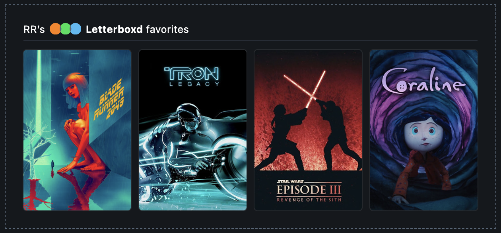
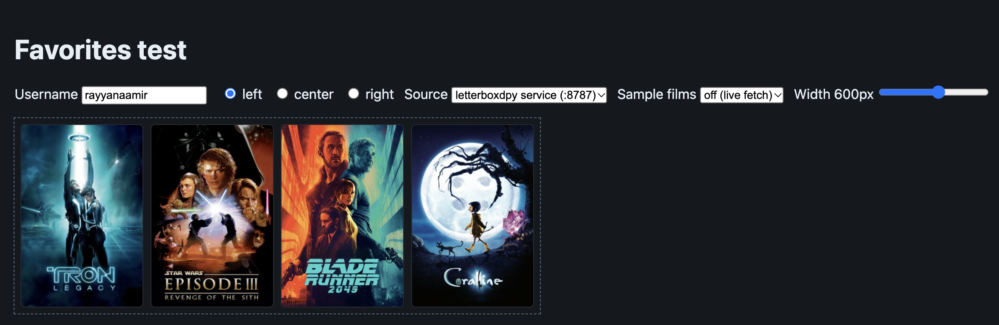

# react-letterboxd-favorites



Show a Letterboxd user's four favorite films in a React or Next.js app, including custom (Patron) posters.

Letterboxd has no API and blocks plain requests with Cloudflare. So you fetch your favorites **once, on your machine**, save them as a JSON file in `public/`, and the component reads that file. No proxy or server is needed at runtime.

Features:
- Same left-to-right order as your profile. 1–3 favorites align `left`, `center` or `right`.
- Looks like the Letterboxd app: a dark box headed "`<your name>`'s ●●● **Letterboxd** favorites", with your chosen display name (like "RR", linked to your profile) and Letterboxd's dots.
- Hover or focus a poster for the title, year and a "View on Letterboxd" link. Optionally, your own rating and like too.
- Custom (Patron) posters by default, with a flag for the standard ones.
- Styled by an optional stylesheet, with Letterboxd's font stack. Every colour and the font are CSS variables, and every element takes extra classes.
- Live scraping is available as an **experimental** fallback.

> Not affiliated with or endorsed by Letterboxd. Letterboxd is a trademark of Letterboxd Limited.

## Getting the data

| Approach | Talks to Letterboxd | Needs | Custom posters | Status |
|---|---|---|---|---|
| [**1. Cached JSON**](#1-cached-json-recommended) | Once, from your machine | The bridge *or* a saved profile page, only while syncing | Yes | Recommended |
| [2. Live scrape via the bridge](#2-live-scrape-through-the-bridge-experimental) | Every page load | A Python server running next to your site | No | Experimental |
| [3. Live scrape directly](#3-live-scrape-directly-experimental) | Every page load | A proxy or server IP that Cloudflare doesn't block | No | Experimental, usually 403 |

"The bridge" is a small local Python server ([`playground/letterboxdpy-service`](playground/letterboxdpy-service/README.md)) that gets past Cloudflare.

## Usage

### 1. Cached JSON (recommended)

1. **Install the package** in your app:

   ```bash
   npm install react-letterboxd-favorites
   ```

2. **Start the bridge** (needs Python 3.10+). In a separate terminal, from a clone of this repo:

   ```bash
   cd playground/letterboxdpy-service
   python3.10 -m venv .venv
   source .venv/bin/activate
   pip install -r requirements.txt
   python app.py        # leave it running
   ```

   *No Python?* Skip this step and use the saved-page route in step 3.

3. **Sync your favorites.** From your app's root:

   ```bash
   npx react-letterboxd-favorites sync <your-username>
   # → public/letterboxd-favorites/<your-username>.json
   ```

   It prints your four films, and marks the ones that use a custom poster. You can stop the bridge now.

   *Saved-page route (no Python):* open `https://letterboxd.com/<your-username>/` in a private window, choose **Save Page As → Web Page, HTML Only**, then run:

   ```bash
   npx react-letterboxd-favorites sync <your-username> --from file --html ~/Downloads/<your-username>.html
   ```

   This route gives the standard posters. See [custom posters](docs/custom-posters.md) to get yours.

4. **Commit the JSON file** to your app's git repo, so it deploys with your site. It lives at `public/letterboxd-favorites/<your-username>.json` (`public/` is your static folder; in Next.js it's served at `/letterboxd-favorites/<your-username>.json`), and that's the only file your site reads.

5. **Render the component.**

   React:

   ```tsx
   import { LetterboxdFavorites } from 'react-letterboxd-favorites'
   import 'react-letterboxd-favorites/styles.css'

   export function Favorites() {
     return <LetterboxdFavorites username="<your-username>" align="center" />
   }
   ```

   Next.js (App Router). Importing the JSON renders the favorites on the server, with no loading state:

   ```tsx
   // app/page.tsx
   import { LetterboxdFavorites } from 'react-letterboxd-favorites'
   import 'react-letterboxd-favorites/styles.css'
   import cache from '@/public/letterboxd-favorites/<your-username>.json'

   export default function Page() {
     return (
       <LetterboxdFavorites
         username="<your-username>"
         films={cache.films}
         displayName={cache.displayName}
       />
     )
   }
   ```

6. **To update it,** change your favorites on Letterboxd, re-run step 3, then commit and deploy.

**Show your rating and like.** Add `showRating` and each poster's hover shows your rating (`★★★★½`) and a heart if you liked it:

```tsx
<LetterboxdFavorites username="<your-username>" showRating />
```

`sync` saves them for you (one extra request per release year, through the bridge). To skip that lookup, run it with `--skip-ratings`. A saved page can't provide them, and live scraping doesn't show them.

**Custom or standard posters.** `sync` saves your custom (Patron) posters by default. To use Letterboxd's standard posters instead, add `--default-posters`:

```bash
npx react-letterboxd-favorites sync <your-username> --default-posters
```



The choice is made when you sync, so re-run it to switch. Details: [custom posters](docs/custom-posters.md), all flags: [CLI reference](docs/cli.md).

### 2. Live scrape through the bridge (experimental)

The page fetches your profile through the bridge on every load, so it needs Python running next to your site.

1. `npm install react-letterboxd-favorites`
2. Start the bridge as in step 2 above, and keep it running wherever the page is served.
3. Render the component with `source="scrape"` and point `corsProxy` at the bridge:

   ```tsx
   import { LetterboxdFavorites } from 'react-letterboxd-favorites'
   import 'react-letterboxd-favorites/styles.css'

   export function Favorites() {
     return (
       <LetterboxdFavorites
         username="<your-username>"
         source="scrape"
         corsProxy={(url) => `http://localhost:8787${new URL(url).pathname}`}
       />
     )
   }
   ```

Shows the standard posters. More: [live scraping](docs/live-scraping.md).

### 3. Live scrape directly (experimental)

Letterboxd usually blocks this with a 403 (`LetterboxdBlockedError`), especially from cloud IPs. Use it only if you have a server or proxy that gets through.

1. `npm install react-letterboxd-favorites`
2. **Next.js server:** fetch in a Server Component and pass the result in:

   ```tsx
   // app/page.tsx
   import { LetterboxdFavorites } from 'react-letterboxd-favorites'
   import { getFavorites } from 'react-letterboxd-favorites/server'
   import 'react-letterboxd-favorites/styles.css'

   export const dynamic = 'force-dynamic' // refetch on every request

   export default async function Page() {
     const films = await getFavorites('<your-username>')
     return <LetterboxdFavorites username="<your-username>" films={films} />
   }
   ```

   **Client-only React:** build a CORS proxy first (copy-paste recipes for a Next.js route and a Cloudflare Worker are in [live scraping](docs/live-scraping.md#cors-proxy-recipes)), then use `source="scrape"` and `corsProxy` as in approach 2.

## More

| | |
|---|---|
| [CLI reference and cache file](docs/cli.md) | All `sync` flags, sources, exit codes and the JSON format |
| [Custom posters](docs/custom-posters.md) | Patron posters, `--default-posters`, and syncing from a saved page |
| [Component reference](docs/component.md) | Props, `classNames` slots, CSS variables and error types |
| [Live scraping](docs/live-scraping.md) | The experimental approaches in full, plus proxy recipes |
| [How it works](docs/how-it-works.md) | The scraping approach and its limits |
| [Development](docs/development.md) | Running the demo and playground, tests and build |

## Limitations

- Synced favorites (and posters) are only as fresh as your last `sync`.
- This is scraping, so it can break whenever Letterboxd changes its markup, and Cloudflare may block requests.
- Only your own rating and like are available, and only from `sync`. The favorites section doesn't include them, and there are no reviews or average ratings.
- Scraping public profile pages may conflict with Letterboxd's terms of use. The MIT license covers this package's code only, not Letterboxd's data, content or trademarks.

## License

[MIT](LICENSE) © 2026 Rayyan Aamir
